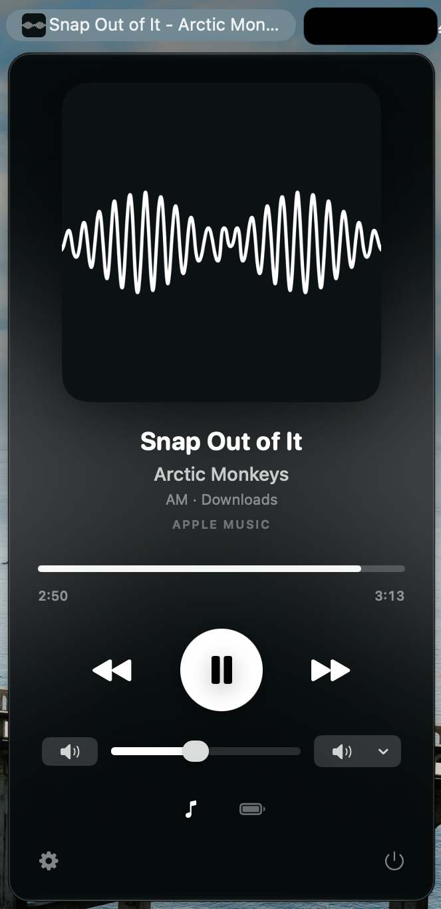
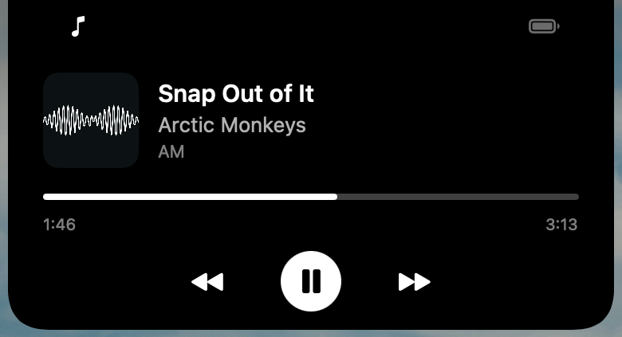

# Music Control

**See what's playing and control your music, right from your menu bar and your MacBook's notch.**

MusicControl is a small, free Mac app that sits quietly at the top of your screen. Glance up to see the song, click to open a beautiful player, or hover over the notch for a quick mini player. No windows to juggle, no switching apps.

<table>
  <tr>
    <td align="center" valign="top">
      <br>
      <sub><b>The menu bar player and audio controls</b></sub>
    </td>
    <td align="center" valign="top">
      <br>
      <sub><b>The notch mini player</b></sub>
    </td>
  </tr>
</table>

## What it does

- **Always know what's playing.** The album cover and song name can sit right in your menu bar.
- **A beautiful player in one click.** Big album art, song details, a progress bar, and play, pause and skip buttons. The colours change to match each album.
- **Hover over the notch.** Move your cursor to the notch and a mini player slides out. Move away and it disappears.
- **Jump anywhere in a song.** Click or drag the progress bar to skip to any point.
- **Control system audio.** Adjust volume, mute audio, and switch between speakers, headphones, and other output devices.
- **Check your battery at a glance.** See charge level, charging state, power source, time remaining, and Low Power Mode.
- **Make it yours.** Turn the album cover, song name or notch player on or off whenever you like. MusicControl remembers your choices.

## Works with

MusicControl has direct integrations with:

| App | Integration |
| --- | --- |
| Apple Music | Direct control and track details |
| Spotify desktop app | Direct control and track details |

It can also show media reported by **any app that publishes macOS Now Playing information**, including browsers. This covers browser-based players such as YouTube Music, Spotify Web Player, video sites, Podcasts, TV, QuickTime, and other compatible media apps. You do not need a separate YouTube Music integration.

## What you need

- A Mac running **macOS 14 (Sonoma) or newer**
- Apple Music, Spotify, or any compatible app playing media
- For the notch player: a MacBook with a notch. Everything else works on any Mac.

## How to install

**1. Download**
Go to the [Releases page](../../releases), and download **MusicControl.zip** from the latest release.

**2. Unzip and move it**
Double-click the downloaded file to unzip it. Then drag **MusicControl** into your **Applications** folder.

**3. Open it for the first time**
Double-click MusicControl in Applications. macOS will show a message saying it can't open the app. This is normal for apps that don't come from the App Store. Here's how to allow it:

1. Click **Done** (or **OK**) on the message.
2. Open **System Settings** and click **Privacy & Security** in the sidebar.
3. Scroll down to the **Security** section. You'll see a message about MusicControl being blocked.
4. Click **Open Anyway** and enter your password or Touch ID.
5. Click **Open** when asked to confirm.

You only need to do this once.

**4. Allow access in Privacy & Security**
For direct Apple Music and Spotify controls, macOS will ask if MusicControl can control **Music** and **Spotify**, with one message for each app that's open. Click **Allow** or **OK** on each one.

If a prompt does not appear, open **System Settings → Privacy & Security → Automation**. Find **MusicControl**, expand it, and enable access to **Music** and **Spotify**. You may need to open the relevant app and play a song before it appears in the list.

Browser and other Now Playing media do not require a separate permission from MusicControl. Battery information also does not require permission.

**5. Play a song and look up**
Start a song in Apple Music or Spotify. You'll see a small music note in your menu bar. Click it to open the player.

## How to use it

- **Click the menu bar icon** to open the player.
- **Click the gear** at the bottom left of the player to choose what appears in your menu bar and to turn the notch player on or off.
- **Hover over the notch** for the mini player. Click the progress bar to skip around in the song.
- **Use the audio row** to adjust volume, mute audio, or choose another connected output device.
- **Use the page buttons** to switch between Music and Battery.
- **Click the power button** at the bottom right of the player to quit.

## Something not working?

**It says "Nothing playing" but music is playing**
MusicControl may not have permission yet.
1. Make sure the music app (Apple Music or Spotify) is open, with a song playing.
2. Open the MusicControl player and click **Allow access to Music & Spotify**. Click **OK** on each message that appears.
3. Still not working? Click **Open Automation settings** in the same window, find **MusicControl** in the list, and make sure the switches next to **Music** and **Spotify** are on.
4. For browser media, make sure the browser tab is actively playing and that the browser publishes Now Playing information to macOS.

**macOS says the app is "damaged" and can't be opened**
This is a safety message macOS shows for downloaded apps, and the app isn't actually damaged. To fix it:
1. Open the **Terminal** app (press Command+Space, type Terminal, press Return).
2. Copy and paste this line, then press Return:
   ```
   xattr -cr /Applications/MusicControl.app
   ```
3. Open MusicControl again.

**I can't see the menu bar icon**
On MacBooks with a notch, icons that don't fit are hidden behind it. Quit one or two other menu bar apps, or hold **Command** and drag icons you don't need out of the menu bar, to make room.

**The notch player doesn't appear**
Open the player, click the gear, and make sure **Notch display** is on. The notch player needs a MacBook with a notch.

**The song name takes too much space in my menu bar**
Open the gear menu and turn off **Song name in menu bar**. You can keep just the album cover or the icon.

## Questions

**Is it free?**
Yes.

**Does it collect any information about me?**
No. MusicControl only talks to media apps and audio devices on your own Mac. It uses the internet for Spotify artwork and optional GitHub update checks. It doesn't collect or share personal information.

**Does it work with Spotify?**
Yes. The Spotify desktop app has direct integration. Spotify Web Player may also appear through macOS Now Playing when it is actively playing in a browser; browser metadata and controls depend on what macOS reports.

**Why does macOS warn me when I open it?**
The downloaded release is distributed outside the Mac App Store. macOS may require you to approve MusicControl in **System Settings → Privacy & Security** before it opens. The installation steps above show you how.

**Does MusicControl need access to my camera, microphone, location, or calendar?**
No. MusicControl only needs Automation access when you use its direct Apple Music or Spotify controls. It does not request camera, microphone, location, or calendar access.

## Feedback and bug reports

Found a problem or have an idea? [Open an issue](../../issues) and tell us what happened, what you expected, and which Mac and macOS version you're using. Screenshots help a lot.

## About

MusicControl is a free macOS menu-bar and notch companion for controlling media without switching away from the current app. It is built with SwiftUI and AppKit, with system media support provided by [MediaRemoteAdapter](https://github.com/ungive/mediaremote-adapter).

MusicControl is an independent project. It does not collect or sell personal information. Music and Spotify access is handled locally through macOS Automation permissions, while browser and other media support uses macOS Now Playing information.

