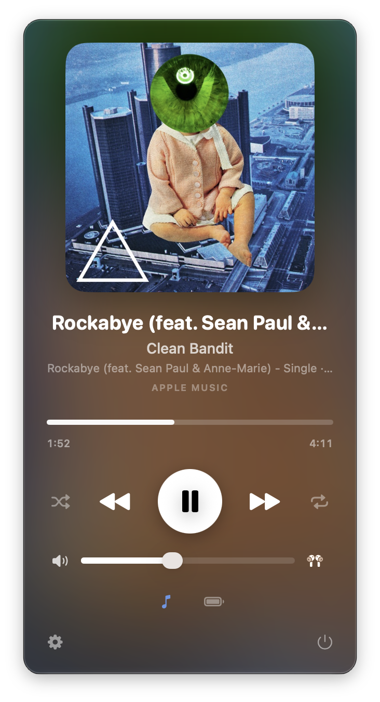
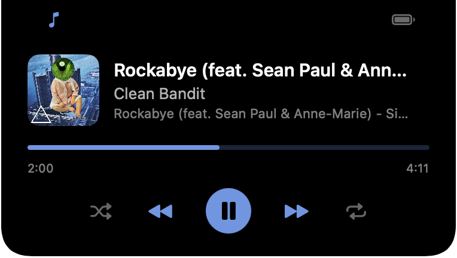

# MusicControl

Control what's playing without leaving the app you're using. MusicControl puts a now-playing display and a full media player in your Mac's menu bar, with an optional mini player in the MacBook notch.

MusicControl is free to use, and every feature is included.

## Screenshots

<table>
  <tr>
    <td align="center" valign="top">
       
      <b>Menu bar player</b>
    </td>
    <td align="center" valign="top">
       
      <b>Notch player</b>
    </td>
  </tr>
</table>

## Features

- See the current track and album artwork in the menu bar, with options to customize what appears.
- Open a player with album art, playback controls, a seekable progress bar, and track details.
- Hover over a MacBook notch for a compact player.
- Adjust system volume, mute audio, and choose an audio output device.
- Use shuffle and repeat with Apple Music and Spotify where supported.
- Set a sleep timer, including an option to stop when the current track ends.
- View battery charge and power information, and optionally receive low-battery alerts.
- Browse playback history stored on your Mac, view lyrics, and favorite tracks in Apple Music.
- Control media from browsers and other apps when they report playback information to macOS.

Each feature can be switched on or off in Settings.

## Supported media apps

Apple Music and the Spotify desktop app have direct integrations for playback details and controls. MusicControl can also pick up media reported through macOS Now Playing, including compatible browsers, Podcasts, TV, QuickTime, and other apps. What is available for those apps depends on the information and controls they provide to macOS.

## Requirements

- A Mac running a macOS version supported by the current release.
- Apple Music, Spotify, or another app that reports media to macOS.
- A MacBook with a notch to use the notch player. The menu bar player works on other Macs too.

## Install

1. Download **MusicControl.zip** from the [latest release](../../releases).
2. Unzip it and move **MusicControl** to your Applications folder.
3. Open MusicControl. If macOS blocks the app because it was downloaded from the internet, open **System Settings → Privacy & Security**, find the notice about MusicControl, and choose **Open Anyway**.
4. To control Apple Music or Spotify directly, allow MusicControl to access each app when macOS asks. You can also manage this under **System Settings → Privacy & Security → Automation**.
5. Start playing media and click the MusicControl icon in the menu bar.

The app stays in the menu bar; open its player there to access Settings and feature switches.

## Build from source

1. Open `MusicControl.xcodeproj` in Xcode.
2. Select the **MusicControl** scheme and run the app.

Xcode resolves the project's Swift package dependencies when needed.

## Troubleshooting

**Nothing is playing, but audio is running**

- Confirm the media app is open and playing.
- For Apple Music or Spotify, allow Automation access in **System Settings → Privacy & Security → Automation**.
- For a browser or another app, confirm that it publishes Now Playing information to macOS.

**The menu bar icon is missing**

On MacBooks with a notch, menu bar items may be hidden when there is not enough room. Try making space by removing or rearranging other menu bar items.

**The notch player does not appear**

The notch player requires a MacBook with a notch. Open MusicControl Settings and make sure the notch feature is enabled.

## Privacy

MusicControl does not collect or sell personal information. Playback history and preferences stay on your Mac. Direct access to Apple Music and Spotify uses macOS Automation permissions. Lyrics and some artwork are retrieved online; update checks contact GitHub. You can turn off automatic update checks in Settings.

MusicControl does not request access to your camera, microphone, location, or calendar.

## Feedback

Found a bug or have an idea? [Open an issue](../../issues). Include your Mac model, macOS version, what you expected, and what happened.

## Credits

MusicControl is built with SwiftUI and AppKit. Browser and other system media support uses [MediaRemoteAdapter](https://github.com/ungive/mediaremote-adapter).
